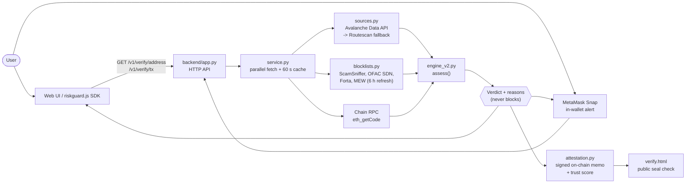

<div align="center">

# RiskGuard

**Check the destination address before you send crypto. Every reason explained, never blocked.**

 -2ea44f?style=for-the-badge)  

</div>

> Engine v2 uses only signals that passed the pre-registered E5 audit. The backend is Python standard library only, so there is nothing to install.

## Tech stack

<p align="center">
  
</p>

## How it works



---

Checks the destination address before a user sends crypto, explains every reason, and never blocks.
Engine v2 uses only signals that passed the pre-registered E5 audit (`../audit/report`).

```
poc/
  backend/        Python 3.10+ standard library only (no dependencies)
    app.py        HTTP API + static hosting       engine_v2.py  pure risk logic
    service.py    parallel fetch + cache          sources.py    Avalanche Data API → Routescan fallback
    blocklists.py daily L0 feeds                  tests/        19 tests incl. E5 regression
    attestation.py signed on-chain memo + trust score (no server-side storage)
  web/            reference UI + sdk/riskguard.js (Frontend handoff) + verify.html (public seal check)
  snap/           MetaMask Snap: in-wallet alert for every transaction (source; build needs Node.js)
  data/seed/      offline blocklist snapshot (used until the first refresh)
  openapi.yaml    API contract                    HANDOFF.md    for the Frontend team (Thai)
```

## Run locally
```bash
python poc/backend/app.py
```
Open http://localhost:8080. Optional settings: copy `backend/.env.example` to `backend/.env`.

## Test
```bash
cd poc
python -m unittest discover -s backend/tests -t .
```

## Deploy (public HTTPS is required for wallets on other devices)
**Docker / Cloud Run** (the original repo already targets GCP):
```bash
cd poc
gcloud run deploy riskguard --source . --region asia-southeast1 --allow-unauthenticated --set-env-vars DATA_API_KEY=...,ALLOWED_ORIGINS=https://your-frontend
```
Any container host works (`docker build -t riskguard . && docker run -p 8080:8080 riskguard`).
For a quick public demo from a laptop, a tunnel such as `cloudflared tunnel --url http://localhost:8080` gives a temporary HTTPS URL.

## Data sources
- Avalanche Data API: history (`/v1/chains/{id}/addresses/{a}/transactions`) and token metadata, for Fuji and C-Chain.
- Chain RPC `eth_getCode`: contract detection.
- Routescan: Ethereum, and automatic fallback when the Data API is rate-limited (circuit breaker).
- Blocklists, refreshed every 6 h: ScamSniffer (daily), OFAC SDN, Forta, MyEtherWallet.

## Privacy
Nothing about a check is written to disk or logs (access logs record path and status only). Results are cached in memory for 60 s.
Community reports store `address, chain, category, time` only.

## Known limits
- Native-coin transfers only.
- Rate limiting is per IP and in memory (one instance). With `TRUST_PROXY=1` the first `X-Forwarded-For` entry is used.
- WalletConnect support is wired but untested without a project id.
