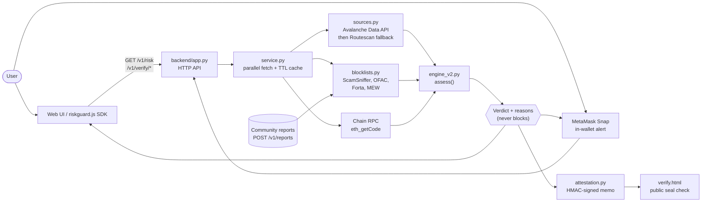
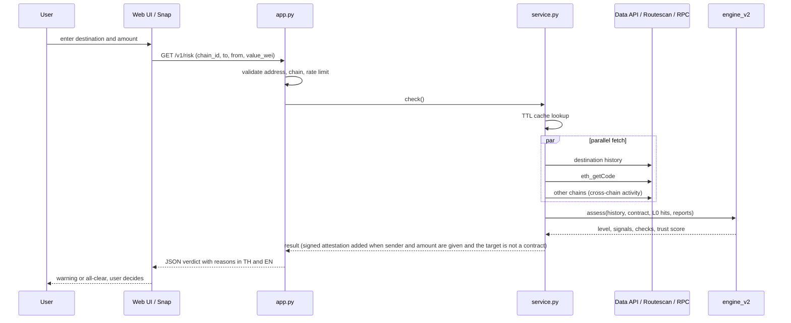
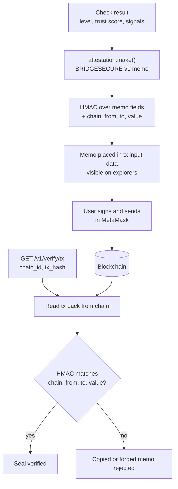

<div align="center">

# RiskGuard / BridgeSecure

**Check the destination address before you send crypto. Every reason explained, never blocked.**

 -2ea44f?style=for-the-badge)   

</div>

<p align="center">
  
</p>

> **Status: pilot / proof of concept.** The backend, reference web wallet page, public seal-check page and a MetaMask Snap (source) exist in this repo. The Snap has not been tested by a human in MetaMask Flask (per `snap/README.md`). Only native-coin transfers are analysed by the backend. This is a risk signal, not a security guarantee.

Last updated: 2026-11-03.

**Credit.** The code history shows the work originated in the `MISZURIE/Bridge-Crypto` repository (package metadata in `snap/package.json` points there; earlier commits are authored by MISZURIE). This repository is a copy maintained by Dxrksvng, with README, badge and diagram work added on top. The product is called "RiskGuard" in the backend code and "BridgeSecure" in the UI, Snap and deploy docs; both names refer to the same system.

---

## Problem

Crypto transfers are irreversible. Users lose funds to wallet drainers, address-poisoning look-alikes, sanctioned or reported recipients and burn addresses, and wallets show only a hex string and a Confirm button. RiskGuard checks the destination at the moment of decision, explains each reason in Thai and English, and lets the user decide.

## Principles

| Principle | Where it shows up in the code |
|---|---|
| Warn-only | The engine returns a verdict and reasons; nothing in the API or Snap blocks a send (`snap/README.md`: "The Snap never blocks"). |
| Audit-backed signals only | `engine_v2.py` carries a `VALIDATION` table per rule: `validated`, `validated-low-recall`, `deterministic`, `not-yet-validated`, `unverified`, `precautionary`. Unvalidated rules are capped (for example `L2_LINKED` shows as MEDIUM). |
| Honest about weak signals | `FRESH_ADDRESS` can raise MEDIUM but never HIGH, because the E5 audit noted "new address" alone also flags many real wallets. |
| No server-side storage of checks | `service.py`: nothing about a check is written to disk or logs. Results are cached in memory for `RISK_CACHE_TTL_S` (default 60 s). |
| Stateless attestation | The analysis result travels inside the user's own transaction as an HMAC-signed memo; verification reads the chain back (`attestation.py`). |
| Stdlib-only backend | `backend/` imports only the Python standard library, so there is nothing to `pip install`. |

---

## Repository layout

```
.
├── backend/
│   ├── app.py            HTTP server, routes, rate limit, static hosting, CORS
│   ├── service.py        Orchestrates a check: parallel fetch, 60 s cache
│   ├── sources.py        Avalanche Data API with Routescan fallback, eth_getCode
│   ├── blocklists.py     L0 feeds (ScamSniffer, OFAC, Forta, MEW) + community reports
│   ├── engine_v2.py      Pure risk logic: signals, verdict, trust score
│   ├── attestation.py    Signed on-chain memo make/parse/verify
│   ├── config.py         Environment-driven configuration, chain table
│   ├── .env.example      Template for local settings
│   └── tests/            test_engine.py, test_api.py, test_attestation.py
├── web/
│   ├── wallet.html/js/css  Reference wallet UI (served at "/" in cloud mode)
│   ├── verify.html/js      Public seal check page
│   ├── index.html, app.js, styles.css
│   └── sdk/riskguard.js    Frontend SDK
├── snap/                 MetaMask Snap (TypeScript, transaction insight)
├── data/seed/            Offline blocklist snapshot
├── openapi.yaml          API contract
├── HANDOFF.md            Backend-to-frontend handoff (Thai)
├── DEPLOY.md             Render + GitHub deploy walkthrough (Thai)
├── Dockerfile, render.yaml
└── handoff.html
```

---

## Tech stack

| Area | Choice (from the repo files) |
|---|---|
| Backend runtime | Python 3.10+ standard library only (`http.server`-style handler, `ThreadPoolExecutor`, `hmac`) |
| Container | `python:3.12-slim` Docker image, runs as non-root user, `/v1/health` healthcheck |
| Hosting config | `render.yaml` (Render blueprint, Singapore region, Docker runtime); Cloud Run mentioned in the previous README |
| Chain data | Avalanche Data API, Routescan (fallback and Ethereum), chain RPC `eth_getCode` |
| Blocklists | ScamSniffer, OFAC SDN, Forta labelled datasets, MyEtherWallet darklist |
| Web | Plain HTML, CSS and JavaScript (no build step), `web/sdk/riskguard.js` |
| Snap | `@metamask/snaps-sdk` ^12.1.0, `@metamask/snaps-cli` ^8.4.1, platform 12.1.0, TypeScript ^5.9.3 |
| Snap tests | `@metamask/snaps-jest`, `jest`, `ts-jest` |

Supported chains (`backend/config.py`): Avalanche Fuji (43113, default), Avalanche C-Chain (43114), Ethereum mainnet (1). Engine version string: `v2.1.0`.

---

## System architecture



## Flow 1: Risk check before a send



## Flow 2: Signed seal on the transaction and public verification



The memo format is documented in `backend/attestation.py` and `/v1/rules`: `BRIDGESECURE|v1|c=<chain>|l=<level>|ts=<score>|s=<signals>|t=<unix>|r=<request_id>|k=<hmac>`. A signed check is valid for sending within 30 minutes (`MAX_AGE_S`).

---

## Risk signals

Signals emitted by `engine_v2.py`: `R4_DRAINER`, `R6_ZERO_VALUE`, `L0_LISTED`, `L2_LINKED`, `POISONING_LOOKALIKE`, `COMMUNITY_REPORTED`, `FRESH_ADDRESS`, `UNVERIFIABLE`, `BURN_ADDRESS`, `CONTRACT`, `TOKEN_CONTRACT`, `FIRST_TIME_RECIPIENT`, `SELF_TRANSFER`, `THIN_HISTORY`, `HIGH_VOLUME`, `CROSS_CHAIN_ACTIVE`. Levels are `HIGH`, `MEDIUM`, `LOW`. The trust score is a 0-100 severity index computed from the address's own evidence, "NOT a probability" (`GET /v1/rules` documents the formula).

Validation figures live in `VALIDATION` inside `engine_v2.py`, quoted from the pre-registered E5 audit (`R4_DRAINER`: recall 0.590 on Ethereum and 0.477 on Avalanche; false-positive rate 0.015 and 0.005). The audit data itself (`audit/`) is not part of this repository, so these numbers are not reproducible from here.

## API endpoints

| Method | Path | Purpose |
|---|---|---|
| GET | `/v1/risk` | Risk check: `chain_id`, `to`, optional `from`, `value_wei`. Rate limited. |
| GET | `/v1/verify/tx` | Verify a signed memo on a transaction (`chain_id`, `tx_hash`). Rate limited. |
| GET | `/v1/verify/address` | Address-level verification (`chain_id`, `address`). Rate limited. |
| POST | `/v1/reports` | Community report: `address`, `chain_id`, `category` (body max 2048 bytes). Stored as unverified. |
| GET | `/v1/chains` | Supported chains and data source |
| GET | `/v1/rules` | Rule validation table, trust-score formula, attestation format |
| GET | `/v1/health` | Health status |
| GET | `/v1/price`, `/v1/market` | Price quotes and market data |
| GET | `/config.js` | Runtime config for the reference UI (WalletConnect project id, default chain, snap id) |
| GET | `/openapi.yaml` | API contract |

---

## Run, test, deploy

Run the backend and reference UI (from the repository root):

```bash
python backend/app.py
```

Then open http://localhost:8080 (default `PORT=8080`). Optional settings: copy `backend/.env.example` to `backend/.env`.

Tests (stdlib `unittest`):

```bash
python -m unittest discover -s backend/tests -t .
```

The test files define 34 test functions (21 engine, 8 API, 5 attestation). `RegressionE5` is skipped unless the audit folder is present.

Docker:

```bash
docker build -t riskguard . && docker run -p 8080:8080 riskguard
```

Snap (`snap/package.json` scripts; needs Node.js):

```bash
cd snap && npm run build   # mm-snap build
cd snap && npm test        # jest
```

`DEPLOY.md` (Thai) walks through a Render blueprint deploy and publishing the Snap to npm. `HANDOFF.md` (Thai) is the integration guide for the frontend team.

### Configuration (`backend/config.py`)

`PORT`, `HOST`, `DATA_API_KEY` (optional), `ROUTESCAN_API_KEY` (optional), `ALLOWED_ORIGINS` (default `*`), `RATE_LIMIT_PER_MIN` (default 30), `RISK_CACHE_TTL_S` (60), `BLOCKLIST_REFRESH_S` (6 h), `UPSTREAM_TIMEOUT_S` (8), `ATTESTATION_SECRET`, `WALLETCONNECT_PROJECT_ID`, `SNAP_ID`, `HOME_PAGE`, `TRUST_PROXY`.

---

## Security, privacy and limitations

- Secrets come from environment variables. `.gitignore` excludes `backend/.env`, `data/.attestation_secret`, `data/community_reports.jsonl` and the blocklist cache. `ATTESTATION_SECRET` must stay constant across restarts or old seals stop verifying.
- Access logs record path and status only, no query strings, so addresses are not logged. Community reports store address, chain, category and time.
- Native-coin transfers only in the backend; the Snap additionally inspects ERC-20 `transfer` and `approve` calls.
- Rate limiting is per IP and in memory (single instance). `ALLOWED_ORIGINS` defaults to `*`; restrict it in production.
- WalletConnect is wired but untested without a project id.
- Snaps that use network access must pass MetaMask's allowlist; until then only MetaMask Flask can install it (`DEPLOY.md`).
- Free Render plan sleeps after about 15 minutes idle (`render.yaml` comment).
- Possible packaging issue (verify before relying on it): `.gitignore` ignores `data/` runtime files, and the Dockerfile copies `data/seed`; `data/seed/blocklists_seed.json` is tracked, so the image build should find it.

## License

No license file is present in this repository. Treat as all rights reserved unless the original authors state otherwise.
